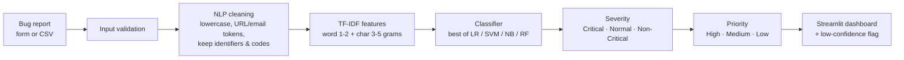

# Architecture

## Modules

| Module | Responsibility |
|---|---|
| `src/utils.py` | Paths, class names, label map, severity→priority map, low-confidence message, exceptions |
| `src/preprocessing.py` | CSV reading (UTF-8/BOM/Windows-1252, single/double quote, Excel-workbook detection), label normalisation, text cleaning and alternative normalisers, near-duplicate grouping, validation |
| `src/predict.py` | `SeverityPredictor`: load model, `predict_one`, `predict_batch`, `predict_csv`, low-confidence flag |
| `src/evaluation.py` | Accuracy, precision/recall/F1 (macro, weighted, per class), confusion matrix, majority baseline |
| `src/modeling.py` | Feature extractors, the four classifiers, group-aware CV, calibration, calibration metrics |
| `src/data.py` | Fixed, leakage-safe evaluation splits (original 20-row test set + held-out collected reports) |
| `src/train.py` | Model comparison by CV macro-F1, held-out evaluation, final fit, `joblib` save, `MODEL_REPORT.md` generation |
| `src/experiments.py` | Research experiments (results in `reports/experiments.json`) |
| `scripts/collect_bugzilla.py` | Collects additional real reports from the public Mozilla Bugzilla REST API |
| `ui/theme.py` | CSS and small HTML components (no user text is ever placed in raw HTML) |
| `ui/content.py` | Example reports, CSV column guide, template/sample CSV generation, upload checks |
| `app.py` | Streamlit pages: Home, Predict, Batch Prediction, Analytics, Model Info, About |

## Training workflow (as used for the shipped model)

1. Load + validate CSV → drop empty text, unknown labels, duplicates.
2. Stratified 80/20 split (seed 42).
3. Repeated stratified k-fold CV on the train split for each candidate pipeline (the TF-IDF vectoriser lives inside the pipeline, so it is fitted per fold – no leakage).
4. Best CV macro-F1 wins; evaluate once on the held-out test split.
5. Re-fit the winner on all rows; save `{pipeline, metadata}` to `models/trained_model.joblib`, metrics to `models/metrics.json`.

The current `src/train.py` extends this (collected data, group-aware CV, calibration); re-running it produces a new model rather than reproducing the shipped one. See `README.md` → *Model performance*.

## Design notes

* The model file bundles preprocessing + vectoriser + classifier, so training and serving cannot drift apart.
* `joblib` files are pickles: load only models you trained yourself. The upstream `*.bin` pickles are intentionally never loaded.
* Probabilities are shown only when the model provides them. Below a 60 % score a prediction is flagged *Low confidence – Manual review recommended.*
* Word2Vec was dropped from the runnable pipeline (see `MODEL_REPORT.md`); the original code remains in the repo for reference.
