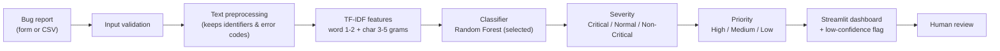

# Batch Bug Severity Prediction System

Predicts the severity of software bug reports – **Critical**, **Normal** or **Non-Critical** – from their text, recommends a priority (High / Medium / Low), and does it for one report or a whole CSV file through an interactive Streamlit dashboard.

> **Status: experimental.** The shipped model was trained on 99 real Mozilla Bugzilla bug summaries. Every prediction is an automated *recommendation* that a person must verify. The model is not production-ready – see [Model performance](#11-model-performance) and [Limitations](#18-limitations).

---

## Contents
1. [Project overview](#2-project-overview) · 2. [Problem statement](#3-problem-statement) · 3. [Objectives](#4-project-objectives) · 4. [Main features](#5-main-features) · 5. [Severity classification](#6-severity-classification) · 6. [Architecture](#7-system-architecture) · 7. [Technologies](#8-technologies-used) · 8. [ML methodology](#9-machine-learning-methodology) · 9. [Dataset](#10-dataset-information) · 10. [Model performance](#11-model-performance) · 11. [Application pages](#12-application-pages) · 12. [Installation](#13-installation-and-setup) · 13. [Run](#14-run-the-application) · 14. [Batch prediction](#15-batch-prediction-instructions) · 15. [Testing](#16-testing) · 16. [Project structure](#17-project-structure) · 17. [Limitations](#18-limitations) · 18. [Future improvements](#19-future-improvements) · 19. [License](#20-license)

## 2. Project overview

Software teams spend considerable time manually reading and prioritising incoming bug reports. This project applies **Natural Language Processing** and **Machine Learning** to the text of a bug report and predicts its severity, so that potentially critical issues can be looked at first.

It is a modernised version of the open-source project [ozsaygin/severity-prediction](https://github.com/ozsaygin/severity-prediction) (originally Word2Vec + MLP, developed in a project supported by Siemens Turkey and Sabancı University). The original scripts no longer run with current libraries; the problems found are documented in [PROJECT_AUDIT.md](PROJECT_AUDIT.md). The original files (`train_and_validate.py`, `eval.py`, `data_helpers.py`, `summaryList.csv`, `*.bin`, `docs/`) are kept unmodified for reference.

## 3. Problem statement

Bug triage – deciding how serious a newly reported bug is – is repetitive and slow when done by hand, and critical problems (crashes, data loss, security issues) can wait in the queue behind trivial ones. An automated classifier that reads the report text and suggests a severity can reduce this manual effort and help surface likely-critical bugs earlier, provided its suggestions are reviewed by a person.

## 4. Project objectives

- Automate bug severity classification from report text.
- Analyse bug report titles and descriptions (with optional steps, expected/actual behaviour and error messages).
- Identify potentially critical bugs.
- Support single bug prediction through a form.
- Support batch bug prediction through CSV upload.
- Provide severity analytics and honest model evaluation.
- Help developers prioritise bug reports.

## 5. Main features

| Feature | What it does |
|---|---|
| **Single bug severity prediction** | Predicts severity, recommended priority and – when the model provides them – class probabilities for one report. |
| **Bug report input form** | Three sections: *Basic information* (title, description – required), *Reproduction details* (steps, expected, actual – optional), *Technical details* (error / stack trace – optional), each with placeholder and helper text. |
| **Example bug reports** | Four demonstration reports (login failure, application crash, UI display issue, minor text issue) with **Load Example** and **Clear Form**. They are illustrative inputs without verified severity labels. |
| **Batch bug severity prediction** | Predicts every row of an uploaded CSV with the same model. |
| **CSV template download** | `bug_reports_template.csv` with the correct headers and 3 illustrative rows. |
| **Sample bug reports download** | `sample_bug_reports.csv` – 10 demonstration reports (login, crash, API, payment, broken link, layout, spelling, image, search, form validation). No severity labels; never used for training or evaluation. |
| **CSV upload, preview and validation** | Detects missing text columns, empty files, rows without text, duplicate rows, Excel workbooks saved with a `.csv` name and malformed rows; accepts UTF-8 (with/without BOM) and Excel's Windows-1252 CSV. Shows totals, valid/invalid counts and a preview before predicting. |
| **Batch prediction results** | Summary counts per severity, filter by severity, table with *Bug Report / Predicted Severity / Recommended Priority / Confidence / Review*. |
| **Prediction results download** | `bug_severity_predictions.csv`: all original columns (original header names) + `predicted_severity`, `priority`, `confidence` (only when the model provides probabilities) and `review`. |
| **Low-confidence flag** | Predictions whose model score is below 60 % are marked *"Low confidence – Manual review recommended."* |
| **Severity analytics** | Training-data distribution, original Bugzilla labels, held-out metrics, class-wise performance, confusion matrix. |
| **Model information dashboard** | Algorithm, features, training data, model comparison, known limitations. |
| **Interactive Streamlit interface** | Six pages with sidebar navigation; light/dark-theme friendly styling. |

## 6. Severity classification

| Severity | Recommended priority | Meaning |
|---|---|---|
| 🔴 **Critical** | High | Potentially serious failure – crashes, hangs, data loss, security problems |
| 🟠 **Normal** | Medium | Moderate functionality issue under some circumstances |
| 🟢 **Non-Critical** | Low | Minor issue with limited impact – cosmetic problems, typos, small requests |

The prediction is an **automated recommendation requiring human verification**; it reflects patterns in historical Mozilla bug reports, not the business impact on your product.

## 7. System architecture

```
Bug Report Input (form or CSV)
       |
       v
Input Validation
       |
       v
Text Preprocessing
       |
       v
TF-IDF Feature Extraction
       |
       v
Machine Learning Classifier
       |
       v
Severity Prediction
       |
       v
Priority Recommendation  -->  Human review
```



Module-level details: [ARCHITECTURE.md](ARCHITECTURE.md).

## 8. Technologies used

Versions are pinned in [`requirements.txt`](requirements.txt) / [`requirements-dev.txt`](requirements-dev.txt) and were verified in the project's virtual environment.

| Technology | Version | Used for |
|---|---|---|
| Python | 3.14.6 (tested) | Language |
| Streamlit | 1.67.0 | Web dashboard |
| pandas | 3.1.1 | CSV handling and tables |
| NumPy | 2.5.5 | Numerical arrays |
| scikit-learn | 1.9.1 | TF-IDF, classifiers, cross-validation, metrics, calibration |
| SciPy | 1.18.1 | Sparse matrices (near-duplicate grouping) |
| Plotly | 7.2.0 | Charts |
| joblib | 1.6.0 | Model persistence |
| pytest | 9.2.0 | Tests (incl. Streamlit `AppTest` UI tests) |

NLP is implemented with scikit-learn's `TfidfVectorizer` and a custom, regex-based cleaner; no external NLP toolkit is required. (The original `data_helpers.py` uses NLTK, and the original scripts use gensim; neither is needed to run this version.)

## 9. Machine learning methodology

The following describes how the **shipped model** (`models/trained_model.joblib`, trained 2026-11-25 06:22 UTC) was produced.

1. **Dataset preparation** – `data/bugzilla_summary_sample.csv` (99 reports). Rows with empty text or unknown labels are dropped, raw Bugzilla severities are mapped to three classes (see [Dataset](#10-dataset-information)).
2. **Text preprocessing** – lower-casing, URLs and e-mail addresses replaced by placeholder tokens, punctuation removed *except* inside technical tokens, so identifiers such as `JS_Assert`, hex addresses such as `0x1012279c` and locations such as `jsobj.c:3697` survive. English stop-words are removed but negations (`not`, `no`, `cannot`, `never`, …) are kept. All text fields of a report (title, summary, description, steps, expected, actual, error) are joined into one text.
3. **Feature extraction** – TF-IDF on word 1–2-grams plus character 3–5-grams (`char_wb`), sub-linear term frequency.
4. **Model comparison** – Logistic Regression, Linear SVM, Multinomial Naive Bayes and Random Forest (class-balanced where supported), each as a full pipeline (vectoriser fitted inside every fold, so no leakage), scored with 5-fold × 3 repeated stratified cross-validation on the training split. **Selection metric: macro-F1** (not accuracy), because the classes are imbalanced.
5. **Model training** – stratified 80/20 split (seed 42): 79 training / 20 test reports. The best model by CV macro-F1, **Random Forest** (300 trees, `class_weight="balanced"`), was evaluated once on the 20 test reports and then re-fitted on all 99 reports.
6. **Model evaluation** – accuracy, macro/weighted precision, recall and F1, per-class metrics, confusion matrix and a majority-class baseline (`src/evaluation.py`).
7. **Model persistence** – the complete pipeline (cleaner + vectoriser + classifier) and its metadata are saved with joblib to `models/trained_model.joblib`; metrics to `models/metrics.json`; [MODEL_REPORT.md](MODEL_REPORT.md) is generated from them.
8. **Prediction workflow** – `SeverityPredictor` (`src/predict.py`) loads the bundle, validates input, predicts severity, maps it to a priority and returns class probabilities plus a low-confidence flag. `predict_one` serves the form, `predict_batch` / `predict_csv` serve CSV files.

**Research code (not yet adopted for the shipped model).** `scripts/collect_bugzilla.py`, `src/data.py`, `src/modeling.py` and `src/experiments.py` add a larger real dataset, near-duplicate-aware (group) cross-validation, probability calibration and a fixed held-out test set. The current `python -m src.train` uses this extended setup, so **re-running it produces a different model** than the one shipped; results of these experiments are in `reports/experiments.json`.

## 10. Dataset information

**Training data of the shipped model:** [`data/bugzilla_summary_sample.csv`](data/bugzilla_summary_sample.csv), a byte-identical copy of the original project's `summaryList.csv` – **99 real Mozilla Bugzilla bug summaries** (columns `summary, severity, status, assigned_to, bug_id`).

* Verified against the public Bugzilla REST API: all 99 summaries and labels match the live records (products Core / Core Graveyard / Firefox Build System, status `VERIFIED`, created 2007-01-02 … 2007-02-11).
* Raw labels: normal 49, critical 35, enhancement 6, major 4, minor 2, trivial 2, blocker 1.

**Label mapping**

| Raw Bugzilla label | Class | Count in training data |
|---|---|---|
| critical, blocker, major | Critical | 40 |
| normal | Normal | 49 |
| minor, trivial, enhancement | Non-Critical | 10 |

Limitations of the mapping: Bugzilla severities are assigned subjectively; `enhancement` is a feature request rather than a defect, and `major` sits between `critical` and `normal`. Both mappings are judgement calls. On a larger sample the model placed most `major` reports with *Normal* (see [PROJECT_AUDIT.md](PROJECT_AUDIT.md) §8).

The current loader also removes one exact duplicate pair (bugs 367589 / 369404 differ only by quote characters), giving 98 rows (Critical 39 / Normal 49 / Non-Critical 10); the shipped model was trained before this change on all 99 rows.

**Additional collected data (research only):** `data/bugzilla_core_verified_2006_2008.csv` – 4,079 real Bugzilla reports collected from the public REST API with the same product/status selection, 2006–2008 (query, date and label rule in the `.provenance.json` and [data/README.md](data/README.md); no e-mail addresses stored). It is **not** used by the shipped model.

**Demonstration data:** the template, sample CSV and example reports offered in the app are illustrative inputs written for this application. They are **not** real Bugzilla data, carry no severity labels and are never used for training or evaluation.

## 11. Model performance

All numbers below were measured, not estimated. Full report: [MODEL_REPORT.md](MODEL_REPORT.md).

**Cross-validation on the 79-report training split (macro-F1, mean ± std):** Random Forest 0.530 ± 0.053 (selected) · Logistic Regression 0.502 ± 0.083 · Linear SVM 0.502 ± 0.083 · Multinomial Naive Bayes 0.468 ± 0.065.

**Held-out test split – 20 reports (Random Forest):**

| Metric | Value |
|---|---|
| Accuracy | 0.800 |
| Macro precision / recall / F1 | 0.571 / 0.583 / **0.563** |
| Weighted precision / recall / F1 | 0.757 / 0.800 / 0.760 |
| Majority-class baseline (always *Normal*) | accuracy 0.500, macro-F1 0.222 |

| Class | Precision | Recall | F1 | Support |
|---|---|---|---|---|
| Critical | 1.00 | 0.75 | 0.86 | 8 |
| Normal | 0.71 | 1.00 | 0.83 | 10 |
| Non-Critical | 0.00 | **0.00** | 0.00 | 2 |

Confusion matrix (rows = actual, columns = predicted; Critical, Normal, Non-Critical): `[6, 2, 0] / [0, 10, 0] / [0, 2, 0]`.

**Independent check on 793 further real reports.** The same shipped model was evaluated on 793 held-out Mozilla Bugzilla reports it had never seen (from the collected 2006–2008 data, excluding all original reports):

| Metric | Value |
|---|---|
| Accuracy | 0.733 |
| Macro-F1 | 0.528 |
| Weighted-F1 | 0.716 |
| Recall – Critical / Normal / Non-Critical | 0.650 / 0.905 / **0.036** (2 of 56) |

Confusion matrix: `[225, 119, 2] / [19, 354, 18] / [2, 52, 2]` (source: `reports/experiments.json`, stage s3).

**What this means.** The 20-report test split is too small to be reliable – one mistake moves a per-class score by many percentage points – and the larger check shows lower performance. The model recognises Critical and Normal reports reasonably often but **practically cannot identify Non-Critical reports**. Results apply to short Mozilla bug summaries of that era; the model is **not production-ready**.

## 12. Application pages

| Page | What you can do |
|---|---|
| 🏠 **Home** | See the number of training reports per class, the current model and its held-out scores, the severity distribution, an explanation of what a bug report is, and quick-start buttons to the other pages. |
| 🔮 **Predict** (Predict Bug Severity) | Fill in the three-section form or load one of four example reports, predict, and see severity, priority, model confidence, the class-probability chart, a low-confidence flag where applicable and the experimental-model warning. **Clear Form** resets everything. |
| 📄 **Batch Prediction** | Read the CSV column guide, download the template or the sample reports, upload a CSV, check the validation summary and preview, run **Predict All Bug Severities**, filter the results and **Download Prediction Results**. Includes *How to Prepare Your CSV File* and an FAQ. |
| 📊 **Analytics** | Training-data severity distribution, original Bugzilla labels, dataset statistics, held-out metrics, class-wise performance, confusion matrix; the collected research data is shown separately and marked as unused by the current model. |
| 🧠 **Model Info** (Model Information) | Algorithm, feature extraction, training data, CV model comparison and known limitations. |
| ℹ️ **About** (About Project) | Problem statement, objectives, technologies, architecture/workflow diagram, file map and future improvements. |

## 13. Installation and setup

Requirements: Windows, macOS or Linux with **Python 3.14** (the pinned package versions require a current Python; tested with 3.14.6) and Git.

```powershell
git clone https://github.com/nnaidev02Amer/Batch-Bug-Severity-Prediction.git
cd Batch-Bug-Severity-Prediction

python -m venv .venv            # or: py -3.14 -m venv .venv
.\.venv\Scripts\Activate.ps1

python -m pip install --upgrade pip
pip install -r requirements.txt          # app only
pip install -r requirements-dev.txt      # app + pytest (for running the tests)
```

If PowerShell blocks the activation script, run `Set-ExecutionPolicy -Scope CurrentUser RemoteSigned` once.

The trained model is included in the repository (`models/trained_model.joblib`), so no training is needed to run the app.

## 14. Run the application

```powershell
streamlit run app.py
```

Open **http://localhost:8501** in your browser. If that port is already in use, run `streamlit run app.py --server.port 8502` and open http://localhost:8502.

Optional:

```powershell
python -m src.train                    # retrain (extended setup – produces a NEW model, overwrites models/ and MODEL_REPORT.md)
python -m src.train --original-only    # retrain on the original sample only (current pipeline; also differs from the shipped model)
python scripts/collect_bugzilla.py     # re-collect the research dataset from the public Bugzilla API
```

Use from Python:

```python
from src.predict import SeverityPredictor
p = SeverityPredictor()
p.predict_one(title="Crash on startup", description="Browser crashes when opening a page",
              error="Assertion failure 0x1012279c")
```

## 15. Batch prediction instructions

1. Open **📄 Batch Prediction** in the sidebar.
2. Click **Download CSV Template** (`bug_reports_template.csv`).
3. Open the CSV in Microsoft Excel (or Google Sheets / LibreOffice).
4. Enter one bug report per row (replace the three example rows).
5. Keep the column names unchanged (you may delete optional columns you don't use).
6. Save as CSV – in Excel: *File › Save As › CSV UTF-8 (Comma delimited)*. Excel's plain "CSV (Comma delimited)" is accepted too. `.xlsx` files are not accepted.
7. Upload the CSV under **Upload Your Bug Reports**.
8. Check the validation summary (records detected / valid / invalid / missing columns) and the preview.
9. Click **Predict All Bug Severities**.
10. Filter the results if needed and click **Download Prediction Results** (`bug_severity_predictions.csv`).

**CSV columns** (names are case-insensitive; these are exactly the columns `SeverityPredictor.predict_batch` reads):

| Column | Required | Description | Example |
|---|---|---|---|
| `title` | at least one text column* | Short bug title | Login fails with HTTP 500 |
| `summary` | at least one text column* | One-line summary (Bugzilla style; alternative to `title`) | Crash when printing |
| `description` | at least one text column* | What happened | Valid credentials show a server error |
| `steps` | optional | Steps to reproduce | 1. Open login 2. Submit |
| `expected` | optional | Expected result | Dashboard opens |
| `actual` | optional | Actual result | HTTP 500 page |
| `error` | optional | Error message / stack trace | 500 Internal Server Error |

\*Recommended: `title` + `description`. Technically any one of the seven text columns is enough; a row with no text in any of them is reported as *Invalid (empty text)*. **No severity column is needed.** Other columns (IDs, owners, …) are kept unchanged in the results. Practical limit: 5,000 rows per file and 20 MB upload size.

## 16. Testing

```powershell
pip install -r requirements-dev.txt
pytest -v
```

Latest verified result (2026-11-25, Python 3.14.6, Windows): **101 passed**.

| Test file | Covers |
|---|---|
| `tests/test_preprocessing.py` | Label mapping, text cleaning, CSV loading and validation |
| `tests/test_training.py` | Training, metrics, model saving, reproducibility |
| `tests/test_prediction.py` | Model loading errors, single and batch prediction |
| `tests/test_improvements.py` | Normalisers, near-duplicates, unknown labels, class imbalance, calibration, model loading, prediction consistency, leakage-safe splits |
| `tests/test_ui.py` | Example loading, Clear Form, required-field and invalid-input validation, results; template/sample CSV generation, valid/invalid/empty uploads, missing columns, batch prediction, result download, column preservation; navigation |
| `tests/test_app.py` | Every page renders without errors; single-prediction smoke test |

UI tests use Streamlit's headless `AppTest`; they do not drive a real browser. Training tests use a small **synthetic** dataset generated in `tests/conftest.py`, which is never used for the shipped model or any reported metric.

## 17. Project structure

```
Batch-Bug-Severity-Prediction/
├── app.py                         # Streamlit application (entry point)
├── ui/
│   ├── __init__.py
│   ├── content.py                 # examples, CSV guide, template/sample CSV, upload checks
│   └── theme.py                   # CSS and UI components
├── src/
│   ├── __init__.py
│   ├── utils.py                   # constants, label map, priority map, exceptions
│   ├── preprocessing.py           # CSV reading, label mapping, text cleaning, validation
│   ├── predict.py                 # SeverityPredictor (single / batch / CSV)
│   ├── evaluation.py              # metrics
│   ├── train.py                   # training, model comparison, report generation
│   ├── modeling.py                # features, classifiers, CV, calibration
│   ├── data.py                    # fixed evaluation splits
│   └── experiments.py             # research experiments
├── scripts/
│   └── collect_bugzilla.py        # collects real reports from the Bugzilla REST API
├── data/
│   ├── README.md
│   ├── bugzilla_summary_sample.csv                    # 99 real reports (training data of shipped model)
│   ├── bugzilla_core_verified_2006_2008.csv           # 4,079 real reports (research)
│   ├── bugzilla_core_verified_2006_2008.provenance.json
│   └── sample_batch_upload.csv                        # 15 real summaries for trying batch upload
├── models/
│   ├── trained_model.joblib       # shipped model
│   └── metrics.json
├── reports/
│   └── experiments.json           # research experiment results
├── tests/
│   ├── conftest.py
│   ├── test_app.py
│   ├── test_improvements.py
│   ├── test_prediction.py
│   ├── test_preprocessing.py
│   ├── test_training.py
│   └── test_ui.py
├── docs/                          # original research notebook and report (upstream)
│   ├── Bugzilla-Severity-Detection-Research.ipynb
│   └── Bugzilla-Severity-Detection-Research.pdf
├── .streamlit/config.toml         # theme colour, upload limit
├── README.md · ARCHITECTURE.md · MODEL_REPORT.md · PROJECT_AUDIT.md · LICENSE
├── requirements.txt · requirements-dev.txt · pytest.ini · .gitignore
└── summaryList.csv · train_and_validate.py · eval.py · data_helpers.py · nn_model.bin · w2v_model.bin
                                   # original upstream files, kept unmodified (not used by the app)
```

## 18. Limitations

- **Limited real-world training data:** the shipped model learned from 99 bug summaries from one project and era (Mozilla, 2007).
- **Experimental performance:** accuracy 0.80 on 20 test reports, but 0.73 (macro-F1 0.53) on 793 further real reports.
- **Non-Critical classification:** only 10 training examples; the model found 0 of 2 and 2 of 56 Non-Critical reports in the two evaluations.
- **Dependence on training-data quality:** Bugzilla labels are subjective and inconsistent; the `major → Critical` and `enhancement → Non-Critical` mappings are judgement calls.
- **Domain shift:** modern web-application tickets (like the in-app examples) differ from short Mozilla browser-engine summaries, so predictions for them are especially uncertain.
- **Confidence is a model score**, not a guarantee; the shipped model's scores are not calibrated.
- **Manual verification is required** for every prediction. Not validated for production use.
- Word2Vec (the original approach) could not be re-evaluated: `gensim` does not import with current SciPy on Python 3.14.

## 19. Future improvements

- Adopt a model trained on the larger verified Bugzilla dataset already collected (experiments in `reports/experiments.json`).
- Improve severity classification and **minority-class (Non-Critical) recall**, e.g. calibrated probabilities with a class-prior-aware decision rule.
- Review the severity label mapping with domain experts.
- Advanced NLP features (transformer-based text embeddings), and full bug descriptions instead of one-line summaries.
- Model explainability for individual predictions.
- Integrations with bug trackers (Bugzilla, Jira, GitHub Issues) and learning from triagers' corrections.

## 20. License

Released under the **MIT License** – see [LICENSE](LICENSE). The license text and copyright notice are those of the original project [ozsaygin/severity-prediction](https://github.com/ozsaygin/severity-prediction), whose code, sample dataset and research documents (`docs/`) are included and remain under that license.

The bug report data originates from [Mozilla Bugzilla](https://bugzilla.mozilla.org) (public bug reports).
